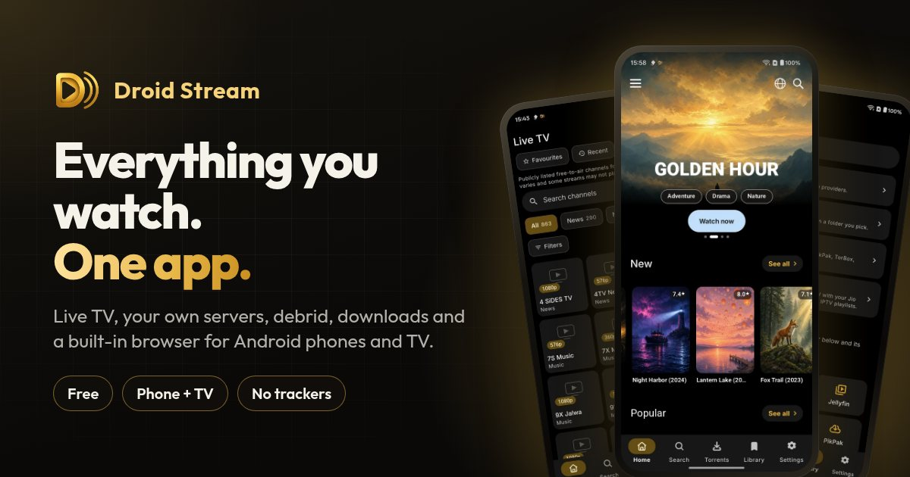
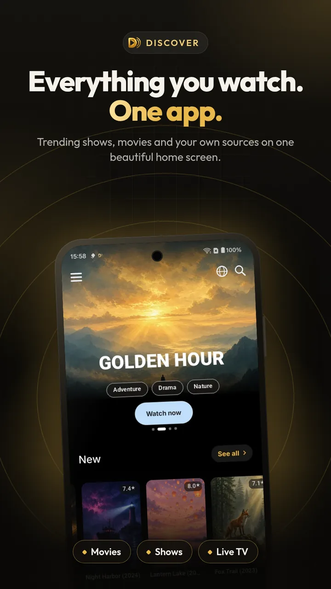
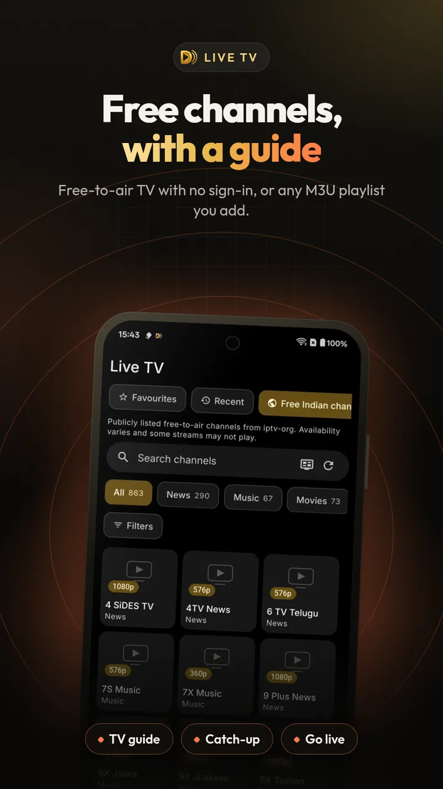
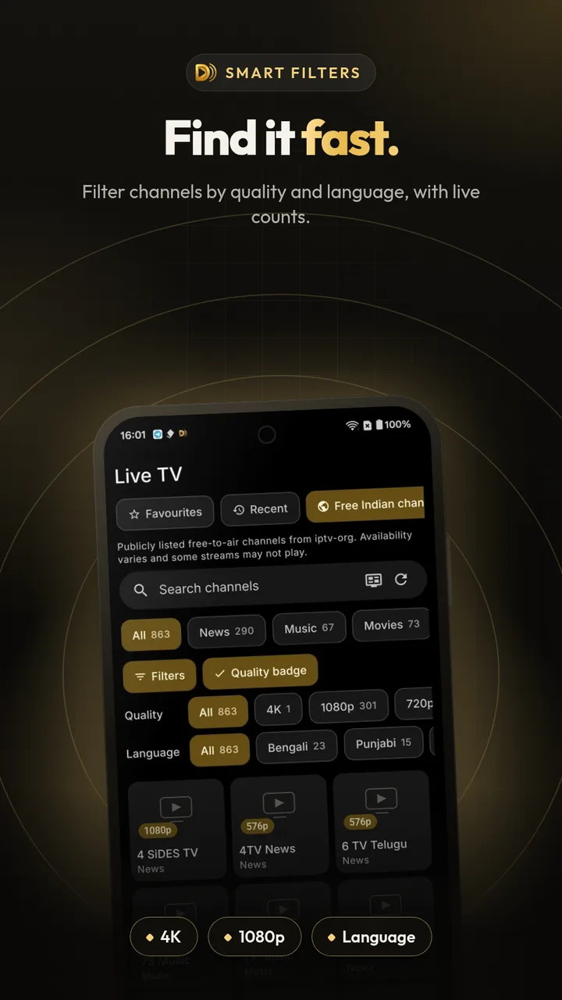
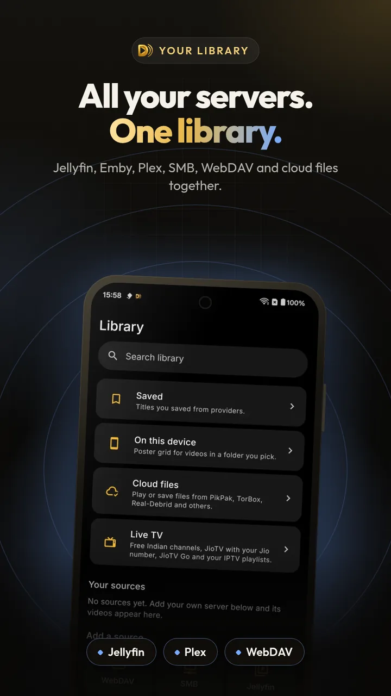
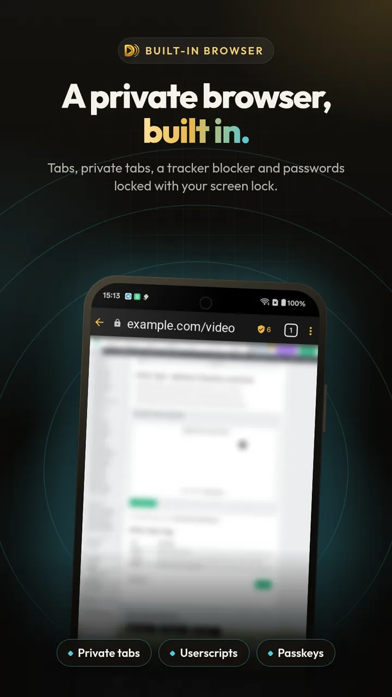
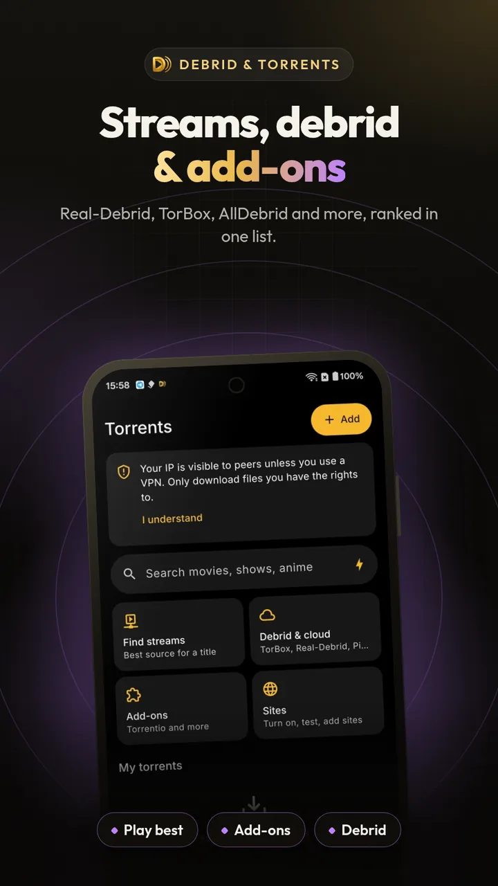
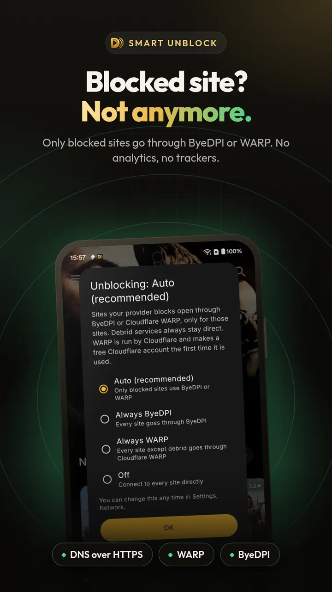
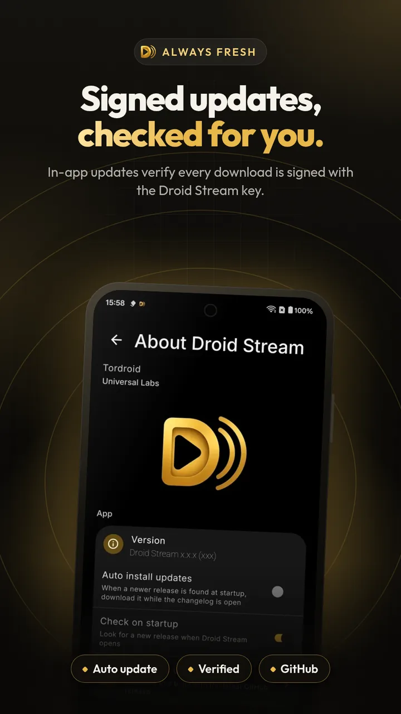

  

<h1 align="center">Droid Stream</h1>

  <b>One media app for live TV, your own servers, cloud and downloads.</b> 
  Free for Android phones, tablets and Android TV, by <a href="https://tordroid.com">Tordroid</a>.

  
  
  

  <a href="https://droidstream.tordroid.com/download"><b>⬇ Download the APK</b></a> ·
  <a href="https://droidstream.tordroid.com">Website</a> ·
  <a href="https://droidstream.tordroid.com/guides/">Guides</a> ·
  <a href="https://droidstream.tordroid.com/changelog/">Changelog</a> ·
  <a href="https://t.me/Tordroid_admin">Telegram</a>

  

Free-to-air channels with a guide, Jellyfin, Emby and Plex, debrid and PikPak, a serious player and a fast downloader, in one private app. No analytics, no trackers.

> This repository only holds the **APK downloads and release notes**. It contains no source code.

## Screens

| | | | |
|:-:|:-:|:-:|:-:|
|  |  |  |  |
| Discover | Live TV | Filters | Library |
|  |  |  |  |
| Browser | Torrents | Smart unblock | Updates |

Artwork and titles in the screenshots are placeholder art. Channel logos are replaced.

## Features

### 📺 Live TV
Free-to-air channels from public lists for your country or every country, plus any M3U playlist you add. No sign-in needed for free channels.
- TV guide grid with now and next; free guide files load by themselves for 72 countries
- Catch-up where the channel allows it, and pause and rewind with Go live
- Multi-view: watch 2 to 4 channels at once
- Programme reminders and recording of channels without DRM
- Filter by quality (4K, 1080p, 720p, SD), language and country, with counts

### 🗄️ Your own servers
Jellyfin, Emby, Plex, SMB and WebDAV, or a folder on your phone, in one poster library.
- Movies, Shows and Folders with matched artwork; fix a wrong match
- Plex link code and Jellyfin Quick Connect sign-in
- Progress syncs back to your server, even after you were offline

### ▶️ A serious player
The built-in player, VLC or any player you like.
- Skip intro, recap and credits: off, a button, or automatic
- DTS and TrueHD audio, chapters, and every audio track a source offers
- **New:** subtitle sync tools, dual subtitles and translation with your own service
- Night mode, dialogue boost, picture-in-picture and background audio

### ☁️ Debrid, cloud and add-ons
Sign in to TorBox, Real-Debrid, AllDebrid, Premiumize, Offcloud, Debrid-Link or PikPak.
- Cloud files as a poster library with Continue watching
- Stremio-compatible add-ons that you add; add-on links install in one tap
- **New:** one ranked list of sources, and Play best moves on by itself if one fails

### ⬇️ Downloads
A multi-connection downloader (1 to 32 connections) with a queue, speed limits and a scheduler.
- HLS, MPEG-DASH, FTP and FTPS; fix a download mid-way with a new link
- Whole seasons, and "keep next episodes ready" that refreshes in the background
- **New:** share a link to save media you are allowed to keep, for offline viewing

### 🌐 Built-in browser
Tabs that come back after a restart, private tabs, bookmarks and dark pages.
- Ad and tracker blocker with EasyList and EasyPrivacy, and userscripts
- A list of every video, audio and image on the page
- Passwords locked with your screen lock, and passkeys

### 🛡️ Privacy, security and Smart unblock
Smart unblock is on by default: only the sites your internet provider blocks go through ByeDPI or Cloudflare WARP, and everything else stays direct.
- No analytics and no trackers; sign-ins and keys in encrypted storage
- DNS over HTTPS, and an optional app lock with your fingerprint or screen lock
- Signed, verified updates; modified copies refuse to run
- **New:** rooted phones, TV boxes and custom ROMs are fully supported, and nothing is sent to Google

### 📡 Android TV and casting
A TV layout you drive with the remote, plus Google Cast and DLNA.
- Continue watching in the TV's Watch Next row
- Automatic frame-rate matching and a TV screensaver
- Send your whole setup from phone to TV, encrypted, on your home network

### 👨‍👩‍👧 Profiles and family
Each profile has its own history, library, Continue watching and Live TV favourites.
- Kids mode hides adult content, Torrents and Settings
- PIN lock for each profile, with a wait after wrong tries

### 🔄 Watch sync and calendar
Trakt, Simkl and AniList, signed in with a code or a QR code.
- Scrobbling that keeps working offline
- A calendar of new episodes and alerts at air time
- IMDb, Rotten Tomatoes and Metacritic scores on title pages

### 🧲 Torrent client
A full client for files you have the right to share.
- Stream while it downloads, and pick the files you want
- Speed limits, Wi-Fi only, VPN bind and kill switch
- Seeding stays off until you turn it on

### 🎨 Backup and your look
Export and import everything, or back up to your own WebDAV server automatically.
- Sign-ins included only with your passphrase, encrypted
- AMOLED black and Soft dark themes, accent colours and launcher icons
- Search inside Settings to jump to any option

## One app instead of five

Most media apps do one job well. Droid Stream puts the jobs you would normally spread across several apps into one.

| What you want to do | Usually needs | Droid Stream |
|---|---|---|
| Free-to-air Live TV with a guide, catch-up and multi-view | An IPTV player app | ✅ Built in |
| Watch your Jellyfin, Emby, Plex, SMB and WebDAV media in one library | One client app per server type | ✅ One poster library, one Continue watching |
| Stream from your debrid or cloud account | The service's website or a separate app | ✅ Seven services, shown as a library |
| Fast multi-connection downloads with a scheduler | A download manager app | ✅ Up to 32 connections, HLS, DASH, FTP |
| A private browser with tracker blocking and userscripts | A separate browser | ✅ Built in, passwords behind your screen lock |
| Trakt, Simkl and AniList sync with a new-episode calendar | A tracking app | ✅ QR sign-in, offline scrobbling, alerts |
| Reach sites your internet provider blocks | A VPN for everything | ✅ Smart unblock routes only blocked sites |

- **Locked down, yet root-friendly:** signed, verified updates and tamper protection, without Play Integrity.
- **No analytics at all:** no trackers or analytics SDKs; backups are encrypted with your own passphrase.
- **Phone to TV in seconds:** send your whole setup to your TV with a QR code, encrypted, on your home network.

"Usually needs" describes common app categories, not any specific product. Features of other apps vary and change over time.

## Download

- **Latest version:** [Releases → Latest](https://github.com/1tordroid/Droid-Stream-Releases/releases/latest), or the short link **https://droidstream.tordroid.com/download** (always the latest universal APK)
  - `DroidStream-arm64-vX.Y.Z.apk`: smaller, for almost every phone and TV from the last few years.
  - `DroidStream-universal-vX.Y.Z.apk`: works on every device, including older 32-bit ones. Pick this if unsure.
- **Website:** https://droidstream.tordroid.com
- **Auto-updates** with [Obtainium](https://github.com/ImranR98/Obtainium): add `https://github.com/1tordroid/Droid-Stream-Releases`. The app also checks for signed updates itself.
- **Check a download:** compare it with `SHA256SUMS` in the same release.

Requires Android 9 or newer.

## Guides

- [Install on a phone or tablet](https://droidstream.tordroid.com/guides/install-apk-android/)
- [Install on Android TV](https://droidstream.tordroid.com/guides/install-android-tv/)
- [Add your media server](https://droidstream.tordroid.com/guides/media-server/)
- [Set up a debrid or cloud service](https://droidstream.tordroid.com/guides/debrid-setup/)
- [Live TV and your own playlists](https://droidstream.tordroid.com/guides/live-tv-playlists/)
- [Troubleshooting](https://droidstream.tordroid.com/guides/troubleshooting/)
- [FAQ](https://droidstream.tordroid.com/faq/)

## What's new

Every release and its notes: [Changelog](https://droidstream.tordroid.com/changelog/) · [GitHub Releases](https://github.com/1tordroid/Droid-Stream-Releases/releases)

## Coming soon

- Droid-Stream Firefox extension
- Droid-Stream TV app

## Help

Report problems in [Issues](https://github.com/1tordroid/Droid-Stream-Releases/issues) or on Telegram: https://t.me/Tordroid_admin

## Legal

> [!IMPORTANT]
> Droid Stream does not host, store or provide any media content. You add your own sources and are responsible for using them lawfully. It is not affiliated with any third-party service named here; all trademarks belong to their owners.

[About](https://droidstream.tordroid.com/about/) · [Credits and licences](https://droidstream.tordroid.com/credits/) · [Privacy](https://droidstream.tordroid.com/privacy/) · [Terms](https://droidstream.tordroid.com/terms/) · [Disclaimer and DMCA](https://droidstream.tordroid.com/disclaimer/)

Open-source attribution: [CREDITS.md](./CREDITS.md) · [THIRD_PARTY_NOTICES.md](./THIRD_PARTY_NOTICES.md)

Licence: [PolyForm Noncommercial 1.0.0](./LICENSE) ([human-readable](https://polyformproject.org/licenses/noncommercial/1.0.0)). Personal and other noncommercial use is free. See [NOTICE](./NOTICE).
