

  

<h1 align="center">Droid Stream</h1>

  <b>One media app for live TV, your own servers, add-ons, cloud and downloads.</b> 
  Free for Android phones, tablets and Android TV, by <a href="https://tordroid.com">Tordroid</a>. Now in 55 languages.

  
  
  
  

  <a href="https://droidstream.tordroid.com/download"><b>⬇ Download the APK</b></a> ·
  <a href="https://github.com/1tordroid/Droid-Stream-Releases/releases/latest">Latest release</a> ·
  <a href="https://droidstream.tordroid.com">Website</a> ·
  <a href="https://droidstream.tordroid.com/compare/">Compare</a> ·
  <a href="https://droidstream.tordroid.com/guides/">Guides</a> ·
  <a href="https://droidstream.tordroid.com/changelog/">Changelog</a> ·
  <a href="https://t.me/Tordroid_admin">Telegram</a>

  

Droid Stream is a player and organiser for your own sources: free-to-air channels with a guide, your IPTV playlists, Stremio and Nuvio add-ons, Vega community providers, Jellyfin, Emby and Plex, and debrid and cloud accounts, with a serious player and a fast downloader, in one private app. No ads, no analytics, no trackers.

> This repository only holds the **APK downloads and release notes**. It contains no source code.

## Project status

**Droid Stream is not discontinued. It continues as Droid Stream 6.0.**

- **5.9.10 is the last 5.x release.** The 5.x app was based on [Vega by vega-org](https://github.com/vega-org/vega-app) and keeps its licence and credits.
- **6.0 is a new app written from scratch by Tordroid**, in Kotlin and Jetpack Compose for phones, tablets and Android TV. It does not reuse the 5.x or Vega code, and it comes under its own licence: proprietary, with terms of use you accept at first start.
- 6.0 will update 5.9.10 in place and keep your data. Until then, 5.9.10 is the version to download here.

## New in 5.9.10

- App updates keep downloading when you switch to another app, and pick up where they stopped after a connection drop instead of starting over.

## New in 5.9.9

- 🌍 **The app in 55 languages**, including Hindi, Bengali, Tamil, Telugu, Punjabi and Urdu, with right-to-left layouts for Arabic, Urdu, Persian and Hebrew. Settings › Languages › App language, "Same as device" by default.
- 🏠 **Home Filter**: filter Home by source, type, language and country, and hide watched titles. Your languages and country come first, and See all searches every language and country. Home tabs for you, your country, Movies and Shows. Catalogs from your add-ons become Home rows by themselves.
- 📺 **Live TV that keeps playing**: channel checks hide offline free channels, backup streams take over when one fails, Xtream Codes login, and scheduled recordings of a programme or a series from the guide.
- ⬇️ **Download controls**: speed limit, downloads at once, Wi-Fi or charging only, a daily window, and a checksum check for each download.
- 🔄 **Sync code and watch party**: one sync code or QR code links your phones and TVs, encrypted on the device. Watch party keeps friends in step, each playing from their own source.
- 📲 **Add from phone or PC**: the TV shows a QR code, and you send add-ons, providers or playlists from a phone or computer on your Wi-Fi. Nothing is added until you confirm on the TV.
- 🪶 **Lite mode** for low-memory TVs and phones, and a **screensaver** with seven styles that never starts while a video plays.
- 📐 **TV layout fixes**: everything inside the TV safe area, bigger text and controls, dialogs that scroll, and larger subtitles.
- 🛡️ **Safer by default**: showing or exporting saved passwords asks for your screen lock, the app log hides keys and tokens, and Settings › About › Verify this copy shows the signing certificate.

Every change: [Changelog](https://droidstream.tordroid.com/changelog/) · [GitHub Releases](https://github.com/1tordroid/Droid-Stream-Releases/releases)

## Screens

| | | | |
|:-:|:-:|:-:|:-:|
| 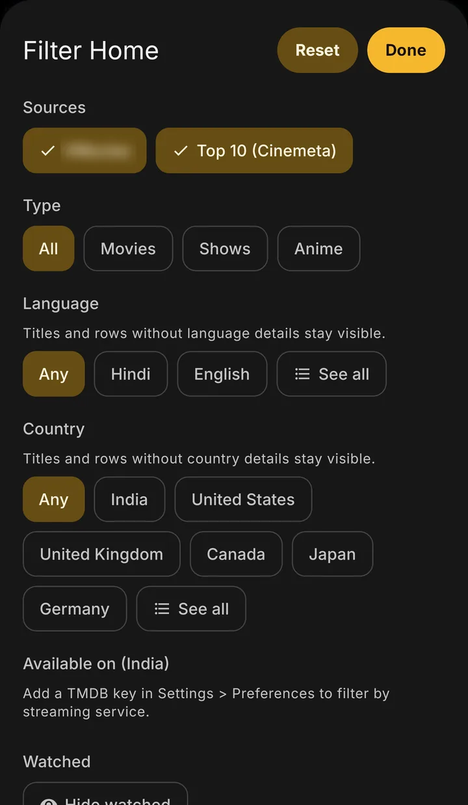 | 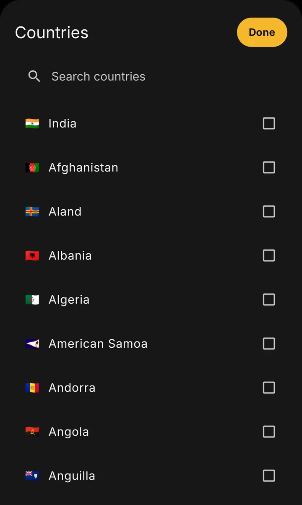 | 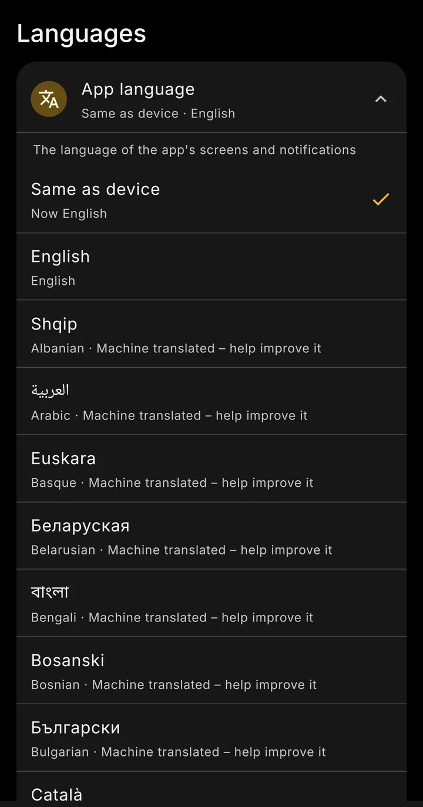 | 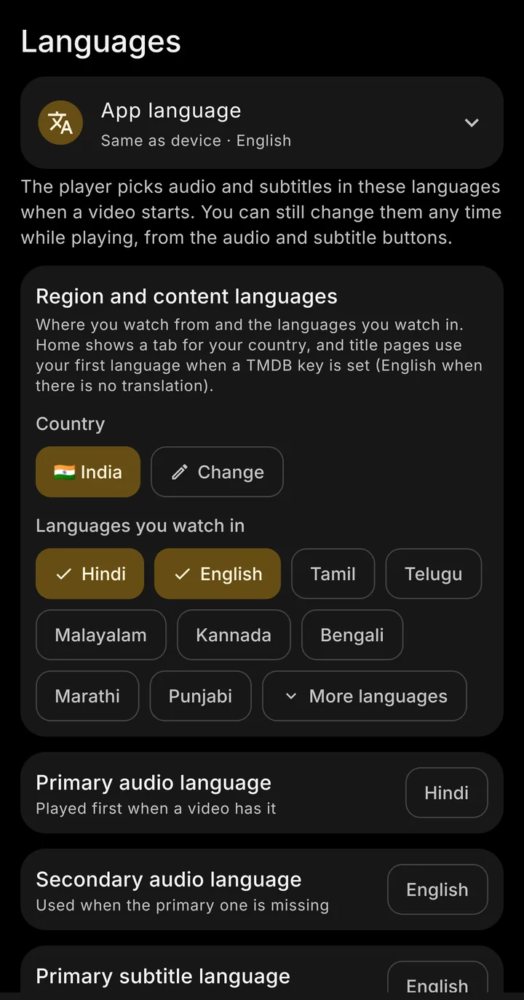 |
| Home Filter | See all, with search | 55 languages | Languages and region |
| 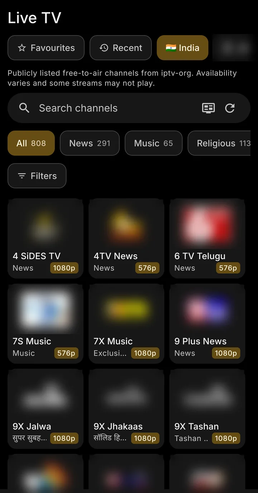 | 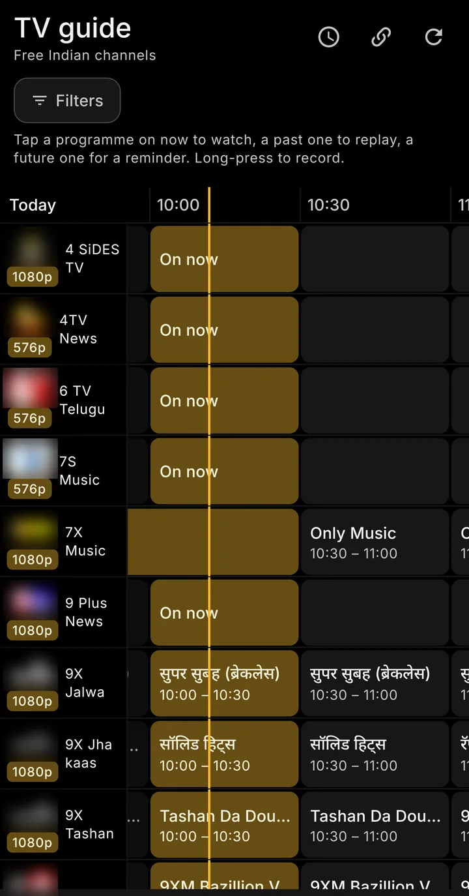 | 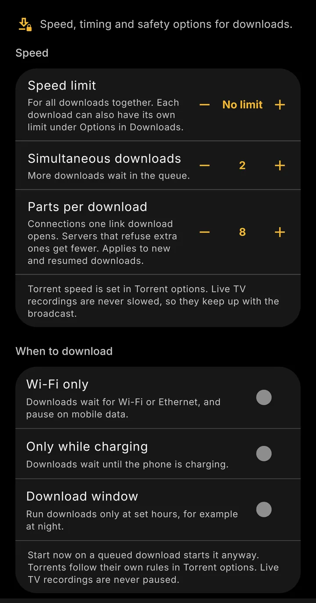 | 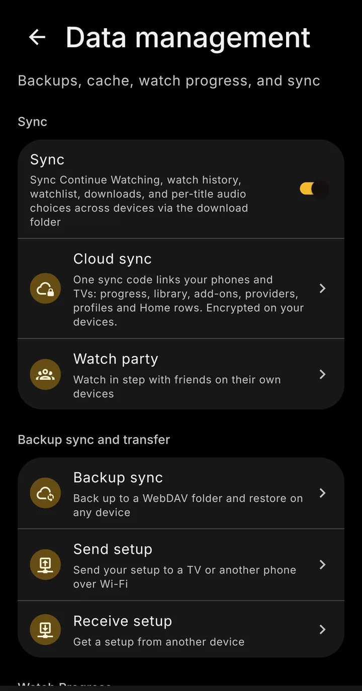 |
| Live TV | TV guide | Download controls | Sync and watch party |
| 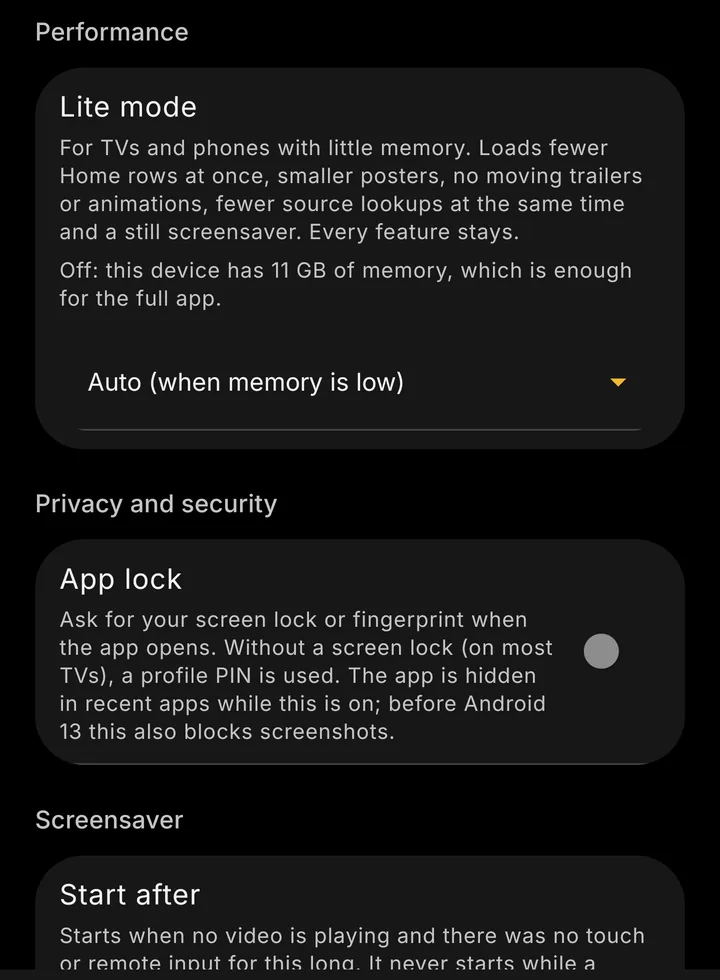 | 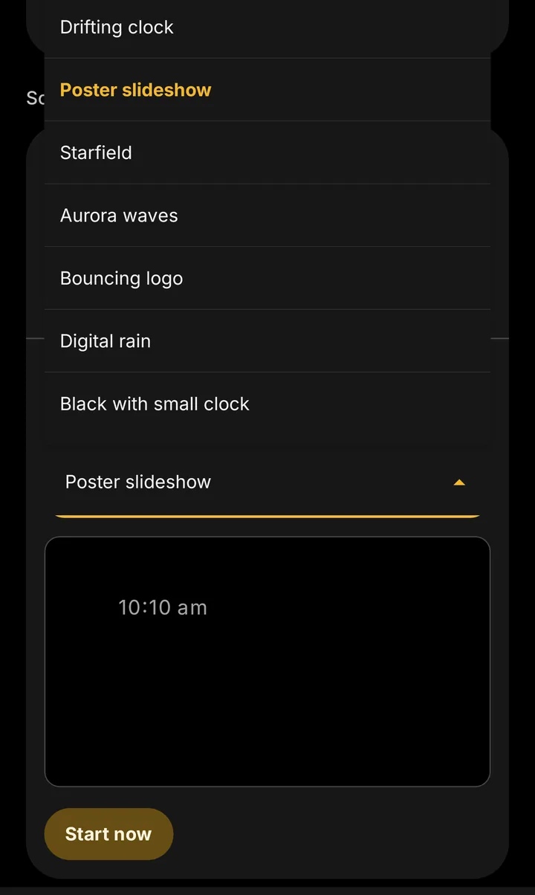 | 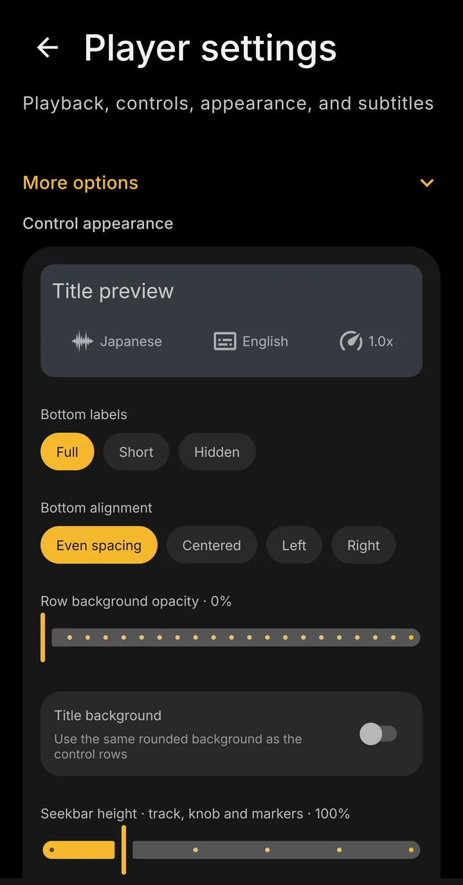 | 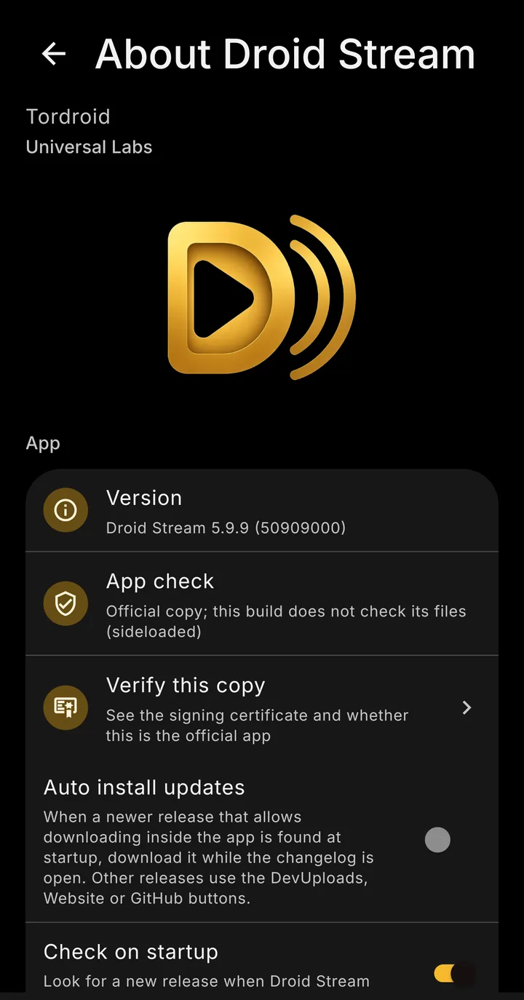 |
| Lite mode | Screensaver | Player controls | Version 5.9.9 |

Screenshots from version 5.9.9 on an Android phone. Channel logos are blurred, and no title artwork is shown.

## Features

### 📺 Live TV
Free-to-air channels from public lists for your country or every country, plus any M3U playlist or Xtream Codes login you add.
- TV guide grid with now and next; free guide files load by themselves for 72 countries
- Catch-up where the channel allows it, pause and rewind, and multi-view for 2 to 4 channels
- **New:** channel checks, backup streams, and scheduled programme or series recordings

### 🧩 Add-ons, debrid and cloud
Stremio and Nuvio add-ons, Vega community providers, and TorBox, Real-Debrid, AllDebrid, Premiumize, Offcloud, Debrid-Link or PikPak. Nothing is installed until you choose.
- **New:** every source of a title in one list, with filters for resolution, HDR, codec, audio and size
- Play best moves on by itself if a source fails

### 🗄️ Your own servers
Jellyfin, Emby, Plex, SMB and WebDAV, or a folder on your phone, in one poster library. Progress syncs back to your server.

### ▶️ A serious player
The built-in player, VLC or any player you like. Skip intro, recap and credits; DTS and TrueHD audio; dual subtitles; night mode and picture-in-picture.
- **New:** your audio language everywhere, and subtitles from your subtitle add-ons

### ⬇️ Downloads
Up to 32 connections, HLS, MPEG-DASH, FTP and FTPS, whole seasons and "keep next episodes ready".
- **New:** download controls with Wi-Fi or charging only and a daily window

### 📡 Android TV and casting
A TV layout you drive with the remote, Google Cast and DLNA, Watch Next and frame-rate matching.
- **New:** bigger text inside the TV safe area, voice search, Add from phone or PC, Lite mode and a screensaver

### 👨‍👩‍👧 Profiles, sync and family
Profiles with their own history and library, kids mode, PIN locks, Trakt, Simkl and AniList.
- **New:** cloud sync with a sync code, watch party, and a region for each profile

### 🛡️ Privacy and security
No analytics and no trackers; sign-ins in encrypted storage; signed, verified updates; Smart unblock for sites your provider blocks; a built-in private browser.

Full list: [droidstream.tordroid.com](https://droidstream.tordroid.com/#features)

## How it compares

We compared Droid Stream 5.9.9 with Stremio, Nuvio, TiviMate, Kodi and CloudStream on 26 features, using only what each app's own pages and documentation say (checked November 2026). In short:

- **Live TV and add-ons in one app:** M3U, Xtream Codes, a guide, catch-up, recordings and multi-view next to Stremio and Nuvio add-ons and Vega community providers.
- **No paid tier:** profiles, kids profiles, downloads, skip intro, multi-view, catch-up and recordings are free. In Stremio some of these are Supporter perks, and TiviMate sells a paid Premium upgrade.
- **Your own servers and seven debrid and cloud services built in**, shown as poster libraries.
- **Private sync and a watch party** where each guest plays from their own source.
- **Where others are stronger:** Stremio and Kodi run on many more platforms, Kodi, Nuvio and CloudStream are GPL open source while Droid Stream's source is private, and Droid Stream needs Android 9 or newer.

Full table, notes and sources: **[droidstream.tordroid.com/compare](https://droidstream.tordroid.com/compare/)**

App names are used only to identify them. Droid Stream is not affiliated with Stremio, Nuvio, TiviMate, Kodi, CloudStream or any service named here.

## Download

- **Latest version:** [Releases → Latest](https://github.com/1tordroid/Droid-Stream-Releases/releases/latest), or the short link **https://droidstream.tordroid.com/download**
  - `DroidStream-arm64-vX.Y.Z.apk`: smaller, for 64-bit Android (most phones and TVs from the last few years).
  - `DroidStream-armv7-vX.Y.Z.apk`: smaller, for 32-bit Android (many TV boxes and sticks, some budget phones).
  - `DroidStream-universal-vX.Y.Z.apk`: works on every device. Pick this if unsure.
- Choose by the Android your device runs, not by its CPU: a 64-bit CPU can still run 32-bit Android.
- **Website:** https://droidstream.tordroid.com
- **Auto-updates** with [Obtainium](https://github.com/ImranR98/Obtainium): add `https://github.com/1tordroid/Droid-Stream-Releases`. The app also checks for signed updates itself.

Requires Android 9 or newer.

## Is this download genuine?

Droid Stream is built from a private source repository. This repository only hosts the official signed releases. Only download from here or [droidstream.tordroid.com](https://droidstream.tordroid.com), never from other sites, mirrors, groups or file-sharing links.

- **In the app:** Settings › About › Verify this copy shows whether this is an official copy, the SHA-256 of its signing certificate, and where Android says it was installed from.
- **Signing certificate (SHA-256):** `76fb06dd1d36edb89ce3ed058c5c520bffcb36eb2667b4707b487138f650d2be`
  (with colons: `76:FB:06:DD:1D:36:ED:B8:9C:E3:ED:05:8C:5C:52:0B:FF:CB:36:EB:26:67:B4:70:7B:48:71:38:F6:50:D2:BE`)
- **Before installing:** `apksigner verify --print-certs DroidStream-arm64-vX.Y.Z.apk`. The line `Signer #1 certificate SHA-256 digest` must match the value above.
- **Checksums:** each release has a `SHA256SUMS` file, and the release notes list the SHA-256 of each APK. On Linux: `sha256sum -c SHA256SUMS --ignore-missing`.
- **GitHub attestation:** `gh attestation verify DroidStream-arm64-vX.Y.Z.apk -R 1tordroid/Droid-Stream-Releases`. This proves the file was published by this repository's release workflow and not changed since. It does not prove which source code it was built from, because the source is private.
- **VirusTotal:** the release notes link to the VirusTotal report of each APK.

If a value does not match, do not install the file. Full guide: [Verify your download](https://droidstream.tordroid.com/verify/) · [VERIFY.md](./VERIFY.md)

## Guides

- [Install on a phone or tablet](https://droidstream.tordroid.com/guides/install-apk-android/)
- [Install on Android TV](https://droidstream.tordroid.com/guides/install-android-tv/)
- [Add your media server](https://droidstream.tordroid.com/guides/media-server/)
- [Set up a debrid or cloud service](https://droidstream.tordroid.com/guides/debrid-setup/)
- [Live TV and your own playlists](https://droidstream.tordroid.com/guides/live-tv-playlists/)
- [Troubleshooting](https://droidstream.tordroid.com/guides/troubleshooting/)
- [FAQ](https://droidstream.tordroid.com/faq/)

## Coming soon

- **Droid Stream 6.0**: a complete rebuild in Kotlin and Jetpack Compose for phones, tablets and Android TV, faster and lighter on low-memory devices. It will update 5.9.10 in place and keep your data. 5.9.10 is the last 5.x release.
- Droid-Stream Firefox extension
- Droid-Stream TV app

## Help

Report problems in [Issues](https://github.com/1tordroid/Droid-Stream-Releases/issues) or on Telegram: https://t.me/Tordroid_admin

## Legal

> [!IMPORTANT]
> Droid Stream does not host, store or provide any media content. You add your own sources and are responsible for using them lawfully. It is not affiliated with any third-party service named here; all trademarks belong to their owners.

Droid Stream is based on [Vega by vega-org](https://github.com/vega-org/vega-app).

[About](https://droidstream.tordroid.com/about/) · [Credits and licences](https://droidstream.tordroid.com/credits/) · [Privacy](https://droidstream.tordroid.com/privacy/) · [Terms](https://droidstream.tordroid.com/terms/) · [Disclaimer and DMCA](https://droidstream.tordroid.com/disclaimer/)

Open-source attribution: [CREDITS.md](./CREDITS.md) · [THIRD_PARTY_NOTICES.md](./THIRD_PARTY_NOTICES.md)

Licence: [PolyForm Noncommercial 1.0.0](./LICENSE) ([human-readable](https://polyformproject.org/licenses/noncommercial/1.0.0)). Personal and other noncommercial use is free. See [NOTICE](./NOTICE).
